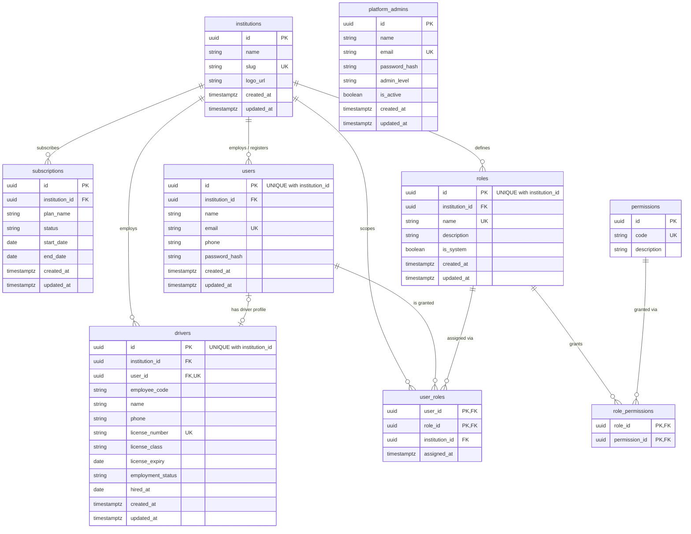
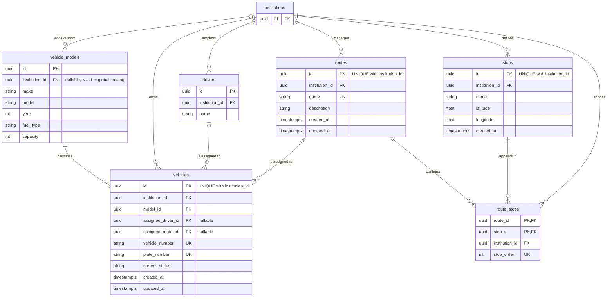
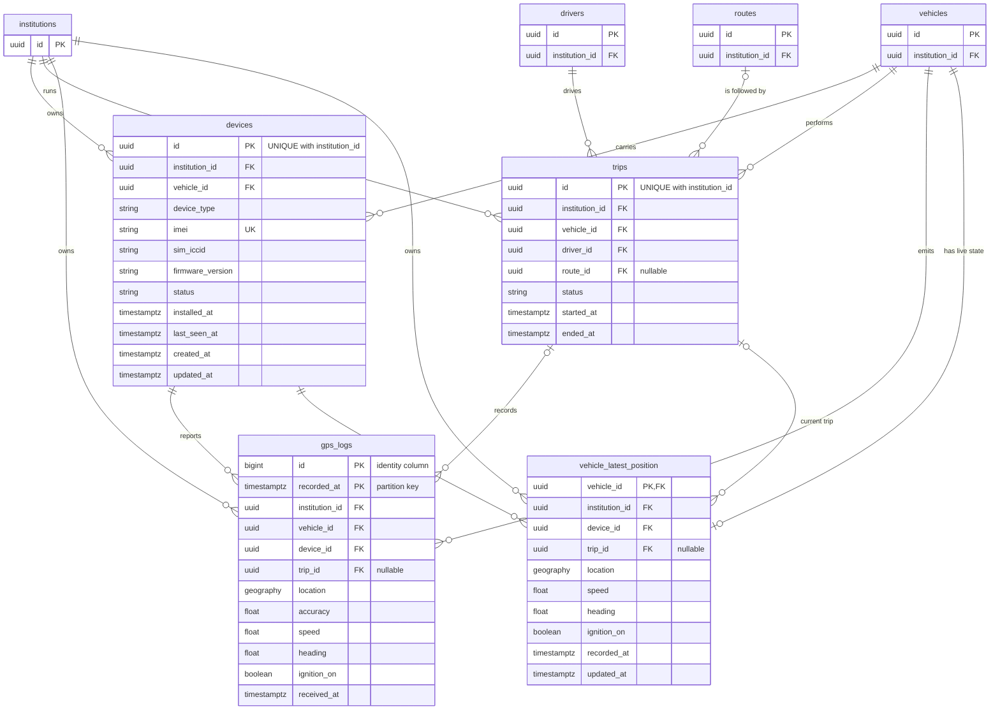
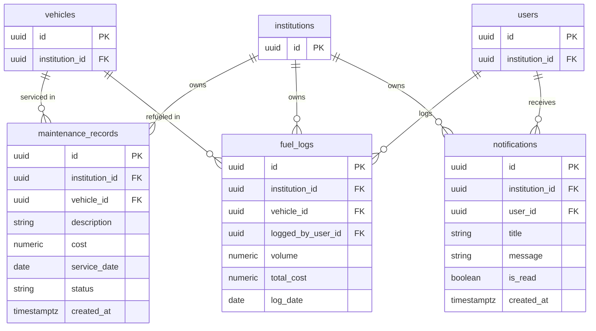

# FleetSync Database Schema Map

**Version 2.0 · Multi-Tenant SaaS Architecture**

Entity-Relationship models for the FleetSync platform, split into four logical views. The architecture enforces strict tenant isolation through composite keys and a shared `institution_id` on every tenant-owned table. Diagrams use Mermaid syntax and render natively on GitHub or in any Markdown viewer that supports Mermaid.

A single combined diagram is available in `fleetsync_er_full.mmd`.

**Legend:** `PK` primary key · `FK` foreign key · `UK` unique key

---

## View 1: Tenancy, Users and Access

Covers the core tenant entity, subscriptions, employee identities (users and drivers), and the Role-Based Access Control (RBAC) model.



> `platform_admins` is platform-level and not tenant-scoped, so it has no relationship to `institutions`.

---

## View 2: Fleet and Assignments

Manages the physical assets, grouping into global or tenant-specific models, and spatial routing definitions.



### Assignment and Model Rules

- `assigned_driver_id` and `assigned_route_id` on `vehicles` are strictly optional. This accommodates dynamic operational workflows such as ride-hailing or on-demand delivery, where a fixed route assignment does not apply.
- `vehicle_models` can act as a global platform catalog (rows where `institution_id IS NULL`). Because of this, safe references to it rely on check functions or triggers rather than purely composite foreign keys.

---

## View 3: Tracking and Trips

The real-time telemetry pipeline: physical devices mapped to vehicles, coordinate trails, and current map state.



### GPS Log Volume Strategy

Telemetry grows much faster than core business entities, so `gps_logs` uses a dedicated volume-management approach:

```sql
CREATE TABLE gps_logs (
    id bigint GENERATED ALWAYS AS IDENTITY,
    recorded_at timestamptz NOT NULL,
    institution_id uuid NOT NULL,
    vehicle_id uuid NOT NULL,
    ...
    PRIMARY KEY (id, recorded_at)
) PARTITION BY RANGE (recorded_at);
```

The time-series partitioning lets older chunks (e.g. `gps_logs_2026_10`) be dropped or rolled up efficiently once retention thresholds have passed. The live state is upserted into `vehicle_latest_position`, which keeps live-map queries off the raw log.

---

## View 4: Maintenance, Fuel and Notifications

Operational records for recurring tasks, expenditures, and communication with system users.



---

## Tenant Isolation Implementation

The schema relies on PostgreSQL-level constraints to prevent data bleeding between tenants. Core entities expose a composite unique key `UNIQUE (institution_id, id)`, so child tables are locked into the same institutional namespace when foreign keys are created.

```sql
ALTER TABLE vehicles ADD CONSTRAINT uq_vehicles_tenant UNIQUE (institution_id, id);

-- Composite FK ensures the referenced vehicle belongs to the same tenant
ALTER TABLE trips ADD CONSTRAINT fk_trips_vehicle
    FOREIGN KEY (institution_id, vehicle_id) REFERENCES vehicles (institution_id, id);
```

Application logic should be paired with connection-level Row Level Security (RLS) configured via `current_setting('app.current_institution_id')`, so tenant boundaries are enforced before queries execute.

---

## Modeling Notes

The source PDF lists keys and column names but not data types or nullability for most columns. The following were inferred when drawing these diagrams:

| Item | Assumption |
|---|---|
| Data types | `uuid` for ids, `timestamptz` for timestamps, `numeric` for money and volume, `boolean` for `is_*` and `ignition_on` flags |
| `gps_logs.location`, `vehicle_latest_position.location` | Drawn as `geography` (PostGIS). The PDF only says `location`. |
| `users` to `drivers` | Optional on both sides, so a driver need not have a login and a user need not be a driver. The PDF marks `drivers.user_id` as FK/UK without stating nullability. |
| Optional FKs | Only `assigned_driver_id`, `assigned_route_id` and `vehicle_models.institution_id` are explicit in the PDF. `trips.route_id`, `gps_logs.trip_id` and `vehicle_latest_position.trip_id` are marked nullable because trips may be route-less and vehicles can move outside trips. |
| Uniqueness scope | `email`, `license_number`, `vehicle_number`, `plate_number`, `imei`, `roles.name` and similar are shown as `UK` as in the PDF. Whether each is globally unique or unique per tenant should be confirmed in the DDL. |
| `UNIQUE with institution_id` | Shown on tables referenced by composite FKs (`users`, `drivers`, `roles`, `vehicles`, `routes`, `stops`, `devices`, `trips`). The PDF only shows this explicitly for `vehicles`. |
